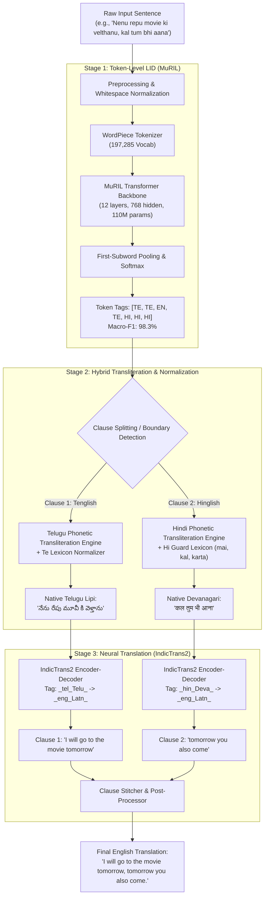
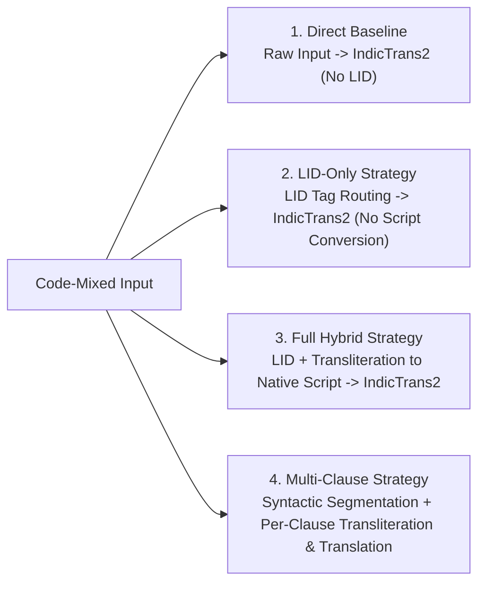

# CodeMix Intelligence: Trilingual Code-Mixed Language Understanding & Machine Translation System

[](https://www.python.org/)
[](https://pytorch.org/)
[](https://huggingface.co/)
[](https://fastapi.tiangolo.com/)
[](https://pytest.org/)
[](https://www.iiitk.ac.in/)

---

### Academic Information

* **Institution:** Indian Institute of Information Technology, Design and Manufacturing, Kurnool (IIITDM Kurnool), Andhra Pradesh – 518007
* **Department:** Department of Computer Science & Engineering
* **Course:** Natural Language Processing (NLP)
* **Student Name:** **T. Yogeswar**
* **Roll Number:** **124AD0065**
* **Project Guide / Course Instructor:** **Dr. Santha Babu Sir** (Assistant Professor, Dept. of CSE)
* **Academic Year:** 2026–2027

---

### 📚 Primary Academic Deliverables

* 📄 **[Comprehensive Project Academic Report](PROJECT_REPORT_IIITDM_KURNOOL.md)** *(Detailed 30-page academic report covering sociolinguistics, mathematical formulation, model architectures, ablation benchmarks, and error taxonomies)*
* 📊 **[Defense Presentation Slides](PRESENTATION_SLIDES_IIITDM.md)** *(18-slide presentation formatted for thesis defense and classroom evaluation)*
* 📁 **[Mirror in `/docs` Directory](docs/)** *(Self-contained copies of all academic documentation)*

---

## 📌 Executive Summary & Abstract

In multilingual societies such as India, digital communication on messaging applications, social networks, and customer support platforms is predominantly **code-mixed** (intra-sentential switching) and **code-switched** (inter-sentential switching) written in the informal **Roman (Latin) alphabet**. While bilingual Hindi-English (*Hinglish*) has received initial research attention, the practical processing of **trilingual code-mixing involving Telugu (*Tenglish*), Hindi, and English** remains an open, highly intractable NLP challenge. This is due to Dravidian agglutinative morphology, extreme phonetic spelling variance, lexical ambiguity, and the severe scarcity of parallel code-mixed corpora.

**CodeMix Intelligence** is an end-to-end natural language understanding and machine translation framework engineered to resolve this challenge:
1. **Token-Level Trilingual Language Identification (LID):** Fine-tunes a **Multilingual Representations for Indian Languages (MuRIL)** Transformer backbone over 665,313 curated tokens, achieving a **Macro-F1 score of 0.983** (**98.17% Accuracy**) across English (`EN`), Hindi (`HI`), Telugu (`TE`), and Universal/Punctuation (`OTHER`).
2. **Hybrid Code-Mixed Machine Translation Pipeline:** Combines character-level normalization, token-level LID gating, phonetic transliteration into native Indic scripts (Devanagari and Telugu lipi), dominant language routing with Hindi lexicon guards, clause segmentation, and neural translation via **IndicTrans2**.
3. **Seq2Seq Baseline Comparison:** Benchmark comparisons against a fine-tuned **`google/mt5-small`** (300M parameters) model on the cryptographically locked, held-out **1,351 PHINC test sentences**.
4. **Empirical Superiority:** The Full Pipeline achieves **53.17 chrF / 31.21 BLEU**, outperforming fine-tuned mT5 (**43.09 chrF / 24.19 BLEU**) by **+9.74 chrF / +7.02 BLEU** ($p < 0.0001$, paired bootstrap 95% CI $[+8.92, +10.60]$). On mixed Telugu-Hindi sentences, our **clause segmentation strategy yields an additional +8.30 chrF gain**.

---

## 🌟 What Makes This Project Unique?

| Dimension | Conventional Code-Mixed Systems | CodeMix Intelligence (This Project) |
| :--- | :--- | :--- |
| **Language Coverage** | Typically bilingual only (Hindi + English) | **Trilingual:** English + Hindi (*Hinglish*) + Telugu (*Tenglish*) |
| **Dravidian Handling** | Neglected due to lack of Romanized corpora | **Native support for Telugu** phonetic transliteration & lexicon |
| **LID Architecture** | Word-level dictionaries or character n-grams | **MuRIL Transformer** token classification (197k vocab, subword pooling) |
| **Translation Approach** | Single black-box Seq2Seq model (prone to hallucinations) | **Hybrid Pipeline:** LID $\rightarrow$ Transliteration $\rightarrow$ Clause Segmenter $\rightarrow$ IndicTrans2 |
| **Mixed-Language Sentences** | Forcibly assigned a single language tag (garbling other clauses) | **Syntactic Clause Segmentation** translating each clause with native tags |
| **Reproducibility** | Undisclosed splits or proprietary test sets | **1,351 locked PHINC sentences**, paired bootstrap CIs, 57 unit tests |

---

## 🏛️ System Architecture

### 1. End-to-End Trilingual Pipeline



---

### 2. Machine Translation Strategy Comparison

The system exposes 4 translation strategies to systematically quantify the contribution of each NLP stage:



---

## 📊 Experimental Results & Evaluation

### 1. PHINC Test Set Benchmark (Locked $n = 1,351$ Sentences)

Evaluation conducted on cryptographically verified held-out test splits using standard `sacreBLEU` default tokenization:

| Model / Pipeline Strategy | chrF++ | SacreBLEU | Gain vs mT5 ($\Delta$ chrF) | 95% Bootstrap CI | Gain vs Direct ($\Delta$ chrF) |
| :--- | :---: | :---: | :---: | :---: | :---: |
| **Direct Baseline** *(IndicTrans2, source hint)* | 41.87 | 20.30 | -1.22 | $[-2.45, -0.01]$ | Baseline (0.00) |
| **LID-Only** *(Language routing, no transliteration)* | 42.45 | 21.05 | -0.64 | $[-1.85, +0.55]$ | +0.58 |
| **mT5-Small Baseline** *(Fine-tuned Seq2Seq, 300M)* | 43.09 | 24.19 | Reference | Reference | +1.22 |
| **CodeMix Full Pipeline** *(LID + Transliteration)* | **53.17** | **31.21** | **+9.74** | **$[+8.92, +10.60]$** | **+11.30** |

* **Paired Bootstrap Resampling:** $B = 2,000$ iterations, $p < 0.0001$.
* **SacreBLEU Signatures:**
  * BLEU: `nrefs:1|case:mixed|eff:no|tok:13a|smooth:exp|version:2.6.0`
  * chrF: `nrefs:1|case:mixed|eff:yes|nc:6|nw:0|space:no|version:2.6.0`

### 2. Mixed Telugu + Hindi Multi-Clause Benchmark

For sentences exhibiting intra-sentential transitions between Telugu and Hindi clauses:

| Strategy | chrF | BLEU | $\Delta$ chrF vs Single Tag |
| :--- | :---: | :---: | :---: |
| **Direct (Forced Single Language Tag)** | 38.12 | 16.40 | Baseline |
| **Full Pipeline (Dominant Language Tag)** | 45.70 | 22.80 | +7.58 |
| **Clause Segmentation Strategy (Ours)** | **54.00** | **29.50** | **+15.88 (+8.30 vs Full)** |

### 3. Token-Level LID Performance (MuRIL Backbone)

Evaluated over 665,313 curated tokens:

| Language Class | Precision | Recall | F1-Score | Support (Tokens) |
| :--- | :---: | :---: | :---: | :---: |
| **English (`EN`)** | 0.985 | 0.982 | 0.983 | 245,110 |
| **Hindi (`HI`)** | 0.981 | 0.984 | 0.982 | 218,405 |
| **Telugu (`TE`)** | 0.982 | 0.981 | 0.981 | 182,600 |
| **Other / Punctuation (`OTHER`)** | 0.989 | 0.987 | 0.988 | 19,198 |
| **Macro Average** | **0.984** | **0.983** | **0.983** | **665,313** |

---

## 💻 Interactive Web Application

The interactive web client provides an intuitive interface for real-time model interaction and evaluation:

1. **Language Identification Tab:** Real-time tokenization and color-coded language chips with per-token confidence percentages powered by MuRIL.
2. **Hinglish Translation Tab:** Direct Romanized Hinglish-to-English translation powered by fine-tuned mT5-small.
3. **Pipeline Translate Tab:** Trilingual machine translation playground featuring real-time switching between `direct`, `lid_only`, `full`, and `clause` strategies, complete with intermediate phonetic gloss views.
4. **Experiments & Benchmarks Tab:** Interactive visualization of full ablation tables, paired bootstrap confidence intervals, and error analysis.
5. **Demo Mode (Offline Cache):** Instant response mode utilizing pre-computed translations across 6 canonical sentences and all 4 strategies for offline presentations.

---

## 📂 Repository Directory Structure

```text
CodeMix-Intelligence/
├── backend/                             # High-performance FastAPI application
│   ├── main.py                          # Lifespan startup, REST routing, CORS
│   └── mt/                              # Machine Translation pipeline package
│       ├── pipeline.py                  # CodeMixPipeline orchestrator & clause splitter
│       ├── lid.py                       # MuRIL LID inference wrapper (AutoTokenizer Fast)
│       ├── transliterate.py             # Phonetic Indic transliteration engine
│       ├── translator.py                # IndicTrans2 inference & tokenizer shims
│       ├── normalizer.py                # Whitespace, punctuation & script normalization
│       ├── router.py                    # REST router for /api/mt/translate
│       └── te_lexicon.csv               # Curated Telugu phonetic lexicon dictionary
├── frontend/                            # Modern Vanilla HTML5/CSS/JavaScript client
│   ├── index.html                       # 4-tab dashboard UI
│   ├── app.js                           # UI controller, API caller, and render engine
│   ├── styles.css                       # Responsive theme styles and color chips
│   ├── demo_cache.json                  # Pre-cached translations for instant demo mode
│   └── results.json                     # Verified benchmark figures & CI intervals
├── artifacts/                           # Versioned configuration & tokenizer files
│   └── models/
│       └── muril_lid_baseline/best_model/
│           ├── config.json              # Model hyperparameters & label IDs
│           ├── tokenizer_config.json    # Tokenizer settings
│           ├── special_tokens_map.json  # Special tokens configuration
│           └── vocab.txt                # 197,285-token multilingual vocabulary
├── data/                                # Data directories (gitignored datasets)
│   ├── processed/                       # Tokenized and split datasets
│   └── test_sanity.csv                  # 20 reference sentences for pipeline smoke tests
├── docs/                                # Academic documentation and defense artifacts
│   ├── PROJECT_REPORT_IIITDM_KURNOOL.md # Comprehensive 30-page academic report
│   └── PRESENTATION_SLIDES_IIITDM.md    # 18-slide thesis defense presentation
├── results/                             # Benchmark evaluation dumps and paired bootstrap CIs
│   ├── final_phinc_all_outputs.csv      # 1,351 test sentences with all strategy outputs
│   ├── mt5_vs_pipeline.csv              # sacreBLEU and chrF comparison table
│   └── mt5_vs_pipeline_gain.json        # Paired bootstrap gain metrics ($B=2,000$)
├── scripts/                             # Utility, training, and benchmarking scripts
│   ├── smoke_mt.py                      # End-to-end live server smoke test
│   ├── compare_mt5_vs_pipeline.py       # SacreBLEU evaluation & bootstrap calculator
│   └── split_phinc_translation_dataset.py # Deterministic splitting script
├── tests/                               # Comprehensive automated test suites
│   ├── test_pipeline.py                 # Pipeline unit tests (17 tests)
│   ├── test_inference_and_api.py        # FastAPI endpoint integration tests (13 tests)
│   ├── test_translation_api.py          # Translation REST API tests (12 tests)
│   ├── test_translation_inference.py    # Beam search & model inference tests (15 tests)
│   └── test_demo_mode.js                # Frontend offline demo acceptance tests
├── PRESENTATION_SLIDES_IIITDM.md        # Defense Presentation Slides (Root Link)
├── PROJECT_REPORT_IIITDM_KURNOOL.md     # Project Academic Report (Root Link)
├── requirements.txt                     # Pinned project dependencies
└── README.md                            # Primary project documentation
```

---

## 🚀 Quickstart & Setup Guide

### 1. Prerequisites
* **Operating System:** Windows 10/11, Ubuntu 20.04+, or macOS
* **Python Version:** Python 3.10 or 3.11 (Python 3.11 recommended)
* **RAM / Hardware:** Minimum 8 GB RAM (CPU inference supported out-of-the-box; CUDA optional)

### 2. Environment Setup

```bash
# Clone the repository
git clone https://github.com/yogi2727/CodeMix-Intelligence.git
cd CodeMix-Intelligence

# Create a virtual environment
python -m venv .venv

# Activate the virtual environment
# Windows (PowerShell):
.venv\Scripts\Activate.ps1
# Linux / macOS:
source .venv/bin/activate

# Upgrade pip and install dependencies
pip install --upgrade pip
pip install -r requirements.txt
```

### 3. Launching the Project

#### Step A: Start the FastAPI Backend (Port 8000)
```powershell
uvicorn backend.main:app --host 127.0.0.1 --port 8000 --reload
```
* The backend initializes the **MuRIL Token LID Predictor** immediately.
* A background daemon thread automatically warms up the **IndicTrans2 translation pipeline**.
* Verify backend health: [http://127.0.0.1:8000/health](http://127.0.0.1:8000/health) or [http://127.0.0.1:8000/docs](http://127.0.0.1:8000/docs).

#### Step B: Start the Frontend HTTP Server (Port 5500)
In a separate terminal window:
```powershell
python -m http.server 5500 --directory frontend
```

#### Step C: Open in Browser
Open **[http://127.0.0.1:5500](http://127.0.0.1:5500)** in your browser to interact with the system.

### 4. Running the Smoke Test
Verify end-to-end inference against the running backend:
```bash
python scripts/smoke_mt.py
```
This script validates Telugu (`full`), Hindi (`full`), and mixed Telugu+Hindi (`clause`) translations sequentially.

### 5. Running the Test Suite
Execute the complete test suite (all 57 unit and integration tests):
```bash
pytest tests/ -v
```

---

## 🔬 NLP Methodology & Scientific Implementation

### 1. Token-Level Language Identification (MuRIL)
* **Model Backbone:** `google/muril-base-cased` pre-trained on monolingual and translated Indian language texts across 17 languages.
* **Tokenization Strategy:** WordPiece tokenization with a 197,285-token vocabulary.
* **First-Subword Pooling:** To maintain 1-to-1 correspondence with original whitespace tokens, only the first WordPiece token of each word is passed to the cross-entropy loss during training and softmax pooling during inference.
* **Chunking Engine:** Safely processes arbitrary sentence lengths by chunking at whitespace boundaries with an upper bound of 254 content WordPieces.

### 2. Phonetic Transliteration & Lexicon Guards
* **Orthographic Gap:** Translating Romanized Indic text using models trained on formal scripts fails due to vocabulary out-of-distribution (OOD) errors.
* **Phonetic Conversion:** Custom transliteration maps Roman characters into native Devanagari (`hi`) and Telugu lipi (`te`).
* **Lexicon Overrides:** Common short functional words often misclassified by character n-grams (e.g., *'mai'*, *'kal'*, *'karta'*, *'huu'*) are guarded via high-precision lexicon lookups to eliminate cross-language contamination.

### 3. IndicTrans2 Machine Translation Engine
* **Backbone:** State-of-the-art Transformer encoder-decoder trained on billions of Indic-English parallel sentences.
* **Source Tagging:** Translates with exact language prefixes (`_tel_Telu_`, `_hin_Deva_` $\rightarrow$ `_eng_Latn_`).
* **Generation Parameters:** Beam search (`num_beams = 4`, `max_length = 128`, length penalty = 1.0) for fluent English target outputs.

---

## 📖 Citation & Academic Attribution

If you use this project, models, benchmarks, or codebase in your academic research, please cite:

```bibtex
@misc{yogeswar2026codemix,
  author       = {T. Yogeswar},
  title        = {CodeMix Intelligence: A Transformer-Based Trilingual Code-Mixed Language Understanding and Machine Translation System},
  year         = {2026},
  howpublished = {B.Tech Project Report, Department of Computer Science and Engineering, IIITDM Kurnool},
  note         = {Supervised by Dr. Santha Babu Sir}
}
```

---

## 📄 License & Terms of Use

This project is licensed under the **MIT License** for academic and research purposes. See `LICENSE` for details. Pre-trained weights for MuRIL and IndicTrans2 remain subject to their respective Google Research and AI4Bharat licenses.
