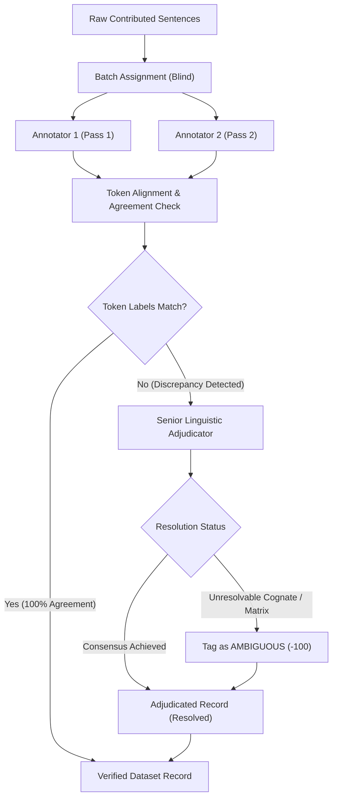

# CodeMix Intelligence V2.1 — Annotation Guidelines
## Token-Level Language Identification Protocol for Trilingual Code-Mixed Text

**Document Version:** `2.0.0`  
**Date:** 2026-11-13  
**Status:** Approved Operational Annotation Protocol  
**Target Directory:** [`outputs/experiments/trilingual_lid_v2_1/`](file:///C:/Users/YOGESWAR/OneDrive/Apps/CodeMix-Intelligence/outputs/experiments/trilingual_lid_v2_1/)  
**Companion Documents:**
- [DATASET_DESIGN.md](file:///C:/Users/YOGESWAR/OneDrive/Apps/CodeMix-Intelligence/outputs/experiments/trilingual_lid_v2_1/DATASET_DESIGN.md)
- [DATASET_SCHEMA.md](file:///C:/Users/YOGESWAR/OneDrive/Apps/CodeMix-Intelligence/outputs/experiments/trilingual_lid_v2_1/DATASET_SCHEMA.md)
- [SOURCE_AND_LICENSING_AUDIT.md](file:///C:/Users/YOGESWAR/OneDrive/Apps/CodeMix-Intelligence/outputs/experiments/trilingual_lid_v2_1/SOURCE_AND_LICENSING_AUDIT.md)
- [PILOT_EVALUATION_DESIGN.md](file:///C:/Users/YOGESWAR/OneDrive/Apps/CodeMix-Intelligence/outputs/experiments/trilingual_lid_v2_1/PILOT_EVALUATION_DESIGN.md)
- [ANNOTATION_PILOT_EXERCISE.md](file:///C:/Users/YOGESWAR/OneDrive/Apps/CodeMix-Intelligence/outputs/experiments/trilingual_lid_v2_1/ANNOTATION_PILOT_EXERCISE.md)

---

## 1. Objective and Core Principles

These guidelines define the operational criteria and quality control protocol for annotating word- and token-level language identification tags across English, Hindi, and Telugu code-mixed text.

### The Five Golden Rules:
1. **Annotate Tokens in Context, Not in Isolation:** Every token is annotated on its linguistic identity within its syntactic clause context.
2. **Never Force an Uncertain Label:** If a token is genuinely indeterminate, shared across languages without disambiguating syntax, or morphemically blended, use `AMBIGUOUS` or `MIXED`. Never guess.
3. **Preserve Exact Surface Form:** Annotate the exact token as typed by the contributor, including typos, repeated characters, and unconventional phonetic transliterations.
4. **Distinguish Language Identity from Writing System:** Language identity is independent of orthography. A Hindi word typed in Latin letters is `HI`. A Telugu word typed in Latin letters is `TE`. A Devanagari word is `HI`. A Telugu script word is `TE`.
5. **Separate Scorable Labels from Training Masks:** The classification model operates on four target classes (`EN`, `HI`, `TE`, `OTHER`). Linguistic nuances (`AMBIGUOUS`, `NE`, `MIXED`) are explicitly annotated and assigned loss-mask value `-100` (`ignore_index`), preventing noisy gradients while preserving linguistic fidelity.

---

## 2. Classification Taxonomy and Tagset

| Tag | Supervised Model ID | Category | Definition & Scope | Examples |
| :---: | :---: | :--- | :--- | :--- |
| **`EN`** | `0` | English | Standard, colloquial, or abbreviated English words functioning as English lexical items. | `school`, `morning`, `meeting`, `very`, `plz`, `office`, `urgent` |
| **`HI`** | `1` | Hindi | Hindi/Urdu lexical items, function words, verbs, and pronouns in Devanagari or Romanized script. | `mai`, `kal`, `ghar`, `jaunga`, `aatta`, `huu`, `मैं`, `कल`, `घर` |
| **`TE`** | `2` | Telugu | Telugu lexical items, postpositions, verbs, pronouns, and clitics in Telugu script or Romanized script. | `akkada`, `adukundam`, `chala`, `ku`, `lo`, `వచ్చాను`, `చేస్తాను`, `బాగుంది` |
| **`OTHER`** | `3` | Universal / Punctuation | Punctuation marks, digits, arithmetic symbols, emojis, emoticons, hashtags, and universal interjections. | `,`, `.`, `!`, `?`, `123`, `:)`, `🔥`, `₹`, `@`, `haha` |
| **`AMBIGUOUS`** | `-100` | Unresolved Shared Cognate | Shared Sanskrit (*tatsama*) or Perso-Arabic words occurring at switch junctions where syntax does not resolve ownership. | `pustak`, `samay`, `duniya`, `dost` (at ambiguous boundaries) |
| **`NE`** | `-100` | Named Entity | Proper personal names, geographic places, institutional titles, and commercial brand names. | `Hyderabad`, `Raju`, `Sita`, `Google`, `Telangana`, `Charminar` |
| **`MIXED`** | `-100` | Intra-Word Code-Switch | Fused morphemes within a single token combining stems and affixes from different languages. | `schoolku` (EN stem + TE clitic), `meetinglo`, `filmon` (EN + HI pl.) |

> [!IMPORTANT]
> Tags with Supervised Model ID `-100` are excluded from model loss calculation in PyTorch (`CrossEntropyLoss(ignore_index=-100)`). They are never coerced into `OTHER` or forced into a target language.

---

## 3. Disambiguation Protocols and Edge-Case Rules

### 3.1 Shared Vocabulary (Sanskrit Tatsama & Perso-Arabic Lexemes)
Hindi and Telugu share thousands of lexical items due to classical Sanskrit borrowing (*tatsama*) and medieval Deccan Perso-Arabic contact (*tadbhav* / Dakhni borrowings).

- **Rule 1.A (Syntactic Frame Resolution):** When a shared cognate is syntactically governed by unambiguous functional words of one language, assign that language.
  - *"meri pustak"* $\rightarrow$ `pustak` is **`HI`** (governed by Hindi feminine possessive pronoun *"meri"*).
  - *"naa pustakam"* $\rightarrow$ `pustakam` is **`TE`** (governed by Telugu possessive pronoun *"naa"* and Telugu nominal suffix *-am*).
  - *"ye samay accha hai"* $\rightarrow$ `samay` is **`HI`** (governed by Hindi demonstrative *"ye"* and copula *"hai"*).
  - *"ee samayam lo"* $\rightarrow$ `samayam` is **`TE`** (governed by Telugu demonstrative *"ee"* and locative postposition *"lo"*).
- **Rule 1.B (Unresolved Boundary Cognates):** When a shared cognate occurs directly at a switch boundary without governing morphology (e.g., between an English verb and a Telugu clause, or in an unpunctuated clause boundary):
  - Assign **`AMBIGUOUS`** (`-100`). Annotators must never make an arbitrary choice.

### 3.2 English Loanwords vs. Code-Switching
Indian languages borrow extensively from English. The distinction between a fully assimilated loanword and an English code-switch must follow strict criteria:
- **Rule 2.A (General Lexical Principle):** In code-mixing language identification, English lexical items (nouns, verbs, adjectives) retain their linguistic tag **`EN`** even if widely recognized in vernacular speech.
  - Examples: `school` $\rightarrow$ `EN`, `office` $\rightarrow$ `EN`, `hospital` $\rightarrow$ `EN`, `ticket` $\rightarrow$ `EN`, `problem` $\rightarrow$ `EN`.
- **Rule 2.B (Morphological Inflection):** If an English root takes a native inflection in a whitespace-separated token:
  - *"ticket lu"* $\rightarrow$ `ticket` is `EN`, `lu` is `TE` (Telugu plural suffix).
  - *"office se"* $\rightarrow$ `office` is `EN`, `se` is `HI` (Hindi ablative postposition).
- **Rule 2.C (Phonetic Transliteration into Native Script):** When an English word is written in Devanagari or Telugu script, tag according to the source language identity:
  - `స్కూల్` (school) $\rightarrow$ **`EN`** (Writing system: `telugu_script`).
  - `ऑफिस` (office) $\rightarrow$ **`EN`** (Writing system: `devanagari`).

### 3.3 Fused Intra-Word Morphology (`MIXED`)
Informal digital chat frequently omits whitespace between lexical roots and grammatical suffixes:
- When a single whitespace-delimited token fuses morphemes from two languages:
  - `schoolku` = `school` (English noun) + `ku` (Telugu dative clitic) $\rightarrow$ Label **`MIXED`** (`-100`).
  - `meetinglo` = `meeting` (English noun) + `lo` (Telugu locative clitic) $\rightarrow$ Label **`MIXED`** (`-100`).
  - `filmon` = `film` (English noun) + `on` (Hindi oblique plural suffix) $\rightarrow$ Label **`MIXED`** (`-100`).
- If whitespace or punctuation separates them:
  - `school ku` $\rightarrow$ `school` (`EN`), `ku` (`TE`).
  - `meeting-lo` $\rightarrow$ `meeting` (`EN`), `-` (`OTHER`), `lo` (`TE`).

### 3.4 Proper Nouns and Named Entities (`NE`)
- Personal names, geographic place names, and commercial organizations are tagged as **`NE`** (`-100`):
  - Names: `Raju`, `Suresh`, `Pooja`, `Amit` $\rightarrow$ `NE`.
  - Places: `Hyderabad`, `Delhi`, `Gachibowli`, `Secunderabad` $\rightarrow$ `NE`.
  - Entities/Brands: `Google`, `WhatsApp`, `SBI`, `Amazon` $\rightarrow$ `NE`.
- Common nouns derived from places or names follow standard lexical labeling (e.g., `hyderabadi` biryani $\rightarrow$ `HI`).

### 3.5 Dakhni and Hyderabadi Regional Contact Features
The Hyderabadi urban dialect represents a centuries-old convergence of Hindi/Urdu, Telugu, and Marathi:
- **The Postposition `ku`:**
  - In a Hindi/Dakhni matrix clause (*"mai usku bola"* = Standard Hindi *"maine usko bola"*), `ku` functions as the dative/accusative marker in Hindi: tag as **`HI`**.
  - In a Telugu matrix clause (*"nenu school ku velthunna"*), `ku` functions as the standard Telugu dative case marker: tag as **`TE`**.
- **Discourse Particles:**
  - `ich` (*"mai ich"* = "I myself"): tag as **`HI`** (Dakhni emphatic particle).
  - `kadha` (*"bagundi kadha"*): tag as **`TE`** (Telugu tag question).
  - `na` (*"kal aana na"*): tag as **`HI`** (Hindi modal particle); (*"vacchey na"*): tag as **`TE`**.

### 3.6 Transliteration Noise, Slang, and Non-Standard Spellings
- Character elongation (*"chaalaaa"*, *"bahutttt"*, *"pleeease"*):
  - Strip emotional lengthening mentally to find lemma: `chaala` $\rightarrow$ `TE`, `bahut` $\rightarrow$ `HI`, `please` $\rightarrow$ `EN`.
- Phonetic variants in Roman script:
  - `aatta` / `aata` / `aatha` $\rightarrow$ `HI` (Hindi verb *aata*).
  - `huu` / `hu` / `hoon` / `hun` $\rightarrow$ `HI` (Hindi auxiliary *hoon*).
  - `chala` / `chaala` / `tsala` $\rightarrow$ `TE` (Telugu adverb *chala*).
  - `enti` / `yenti` / `yemiti` $\rightarrow$ `TE` (Telugu interrogative *enti*).
- Unintelligible strings: If a typo cannot be resolved even with contextual analysis, label as **`OTHER`**.

---

## 4. Dual-Annotator Protocol & Quality Assurance Workflow

To ensure benchmark reproducibility and avoid idiosyncratic annotator bias, all evaluation and validation data must undergo independent dual annotation followed by structured adjudication.

### 4.1 Annotation Stages
1. **Stage 1 — Independent Blind Annotation:**
   - Two qualified bilingual/trilingual annotators independently tag each token.
   - Neither annotator has access to the other's choices, notes, or identity during this stage.
   - Annotators record: `token`, `char_start`, `char_end`, `language_label`, `writing_system`, and optional `notes`.
2. **Stage 2 — Automated Discrepancy Detection:**
   - An automated script compares Pass 1 and Pass 2 annotations token by token.
   - Tokens where `label_1 == label_2` are automatically marked as `agreed`.
   - Discrepancies (`label_1 != label_2`) are flagged and compiled into an adjudication manifest.
3. **Stage 3 — Senior Expert Adjudication:**
   - A qualified senior linguist / reviewer inspects every flagged discrepancy alongside the full sentence context.
   - The adjudicator reviews both proposed labels and applies the disambiguation protocols in Section 3.
   - If the token clearly belongs to a specific language based on syntactic governance, the adjudicator assigns the correct label (`adjudication_status = "adjudicated_resolved"`).
   - If the token is genuinely indeterminate or contested across valid linguistic interpretations, the adjudicator assigns `AMBIGUOUS` (`-100`) (`adjudication_status = "adjudicated_disputed"`).

---

## 5. Procedure for Measuring Inter-Annotator Agreement

Inter-annotator agreement must be formally calculated and recorded for every annotated batch. Agreement calculations must be strictly reproducible.

> [!CAUTION]
> **Prohibition Against Fabricated Scores:**  
> Inter-annotator agreement metrics must NEVER be fabricated or guessed prior to actual data collection and dual annotation. The formulas, procedures, and acceptance thresholds below define the exact evaluation protocol to be executed once human annotations are gathered.

### 5.1 Cohen's Kappa ($\kappa$) Formulation for Token-Level LID
For two independent annotators evaluating $N$ tokens across $K$ nominal categories:

$$\kappa = \frac{P_o - P_e}{1 - P_e}$$

Where:
- **$P_o$ (Observed Agreement):** The proportion of tokens where Annotator 1 and Annotator 2 assigned the identical label:
  $$P_o = \frac{1}{N} \sum_{i=1}^N \mathbb{I}(y_i^{(1)} = y_i^{(2)})$$
- **$P_e$ (Hypothetical Chance Agreement):** The probability that the annotators agree by random chance, based on their marginal class proportions:
  $$P_e = \sum_{c \in \mathcal{C}} P_1(c) \cdot P_2(c) = \sum_{c \in \mathcal{C}} \left( \frac{n_{1,c}}{N} \right) \left( \frac{n_{2,c}}{N} \right)$$
  where $\mathcal{C} = \{\text{EN}, \text{HI}, \text{TE}, \text{OTHER}, \text{AMBIGUOUS}, \text{NE}, \text{MIXED}\}$, and $n_{j,c}$ is the number of tokens Annotator $j$ assigned to class $c$.

### 5.2 Scorable vs. Non-Scorable Agreement Breakdown
To ensure transparency, agreement must be reported in two distinct dimensions:
1. **Primary Scorable Kappa ($\kappa_{\text{scorable}}$):** Computed over the four core target classes $\{\text{EN}, \text{HI}, \text{TE}, \text{OTHER}\}$.
2. **All-Category Fleiss' / Cohen's Kappa ($\kappa_{\text{all}}$):** Computed over the complete 7-class taxonomy including `AMBIGUOUS`, `NE`, and `MIXED`.

### 5.3 Batch Acceptance Criteria and Thresholds
The project establishes strict operational acceptance gates:

| Kappa Value ($\kappa$) | Agreement Level | Operational Action |
| :---: | :---: | :--- |
| **$\kappa \ge 0.85$** | Almost Perfect Agreement | **BATCH ACCEPTED:** Proceed to adjudication and split certification. |
| **$0.75 \le \kappa < 0.85$** | Substantial Agreement | **CONDITIONAL ACCEPTANCE:** Full adjudication required; guideline clarification sent to annotators. |
| **$0.60 \le \kappa < 0.75$** | Moderate Agreement | **BATCH PROBATION:** Adjudication required; mandatory calibration session with annotators; re-annotation of disputed subsets. |
| **$\kappa < 0.60$** | Insufficient Agreement | **BATCH REJECTED:** Batch discarded from benchmark; guidelines revised; annotators retrained before re-collection. |

---

## 6. Training Exercises & Reference Repository

Before beginning annotation on production batches, all annotators must complete the calibration exercise in:
- [ANNOTATION_PILOT_EXERCISE.md](file:///C:/Users/YOGESWAR/OneDrive/Apps/CodeMix-Intelligence/outputs/experiments/trilingual_lid_v2_1/ANNOTATION_PILOT_EXERCISE.md)

This exercise contains 18 diverse, gold-annotated trilingual turns with complete token-by-token syntactic justifications and boundary explanations.
