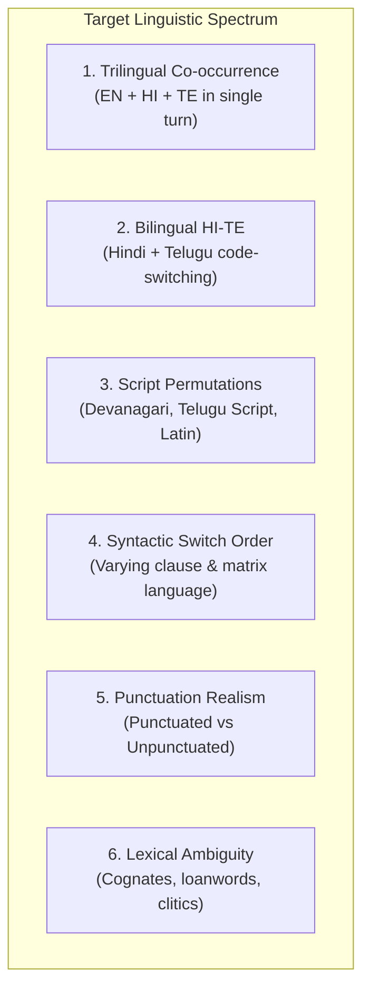
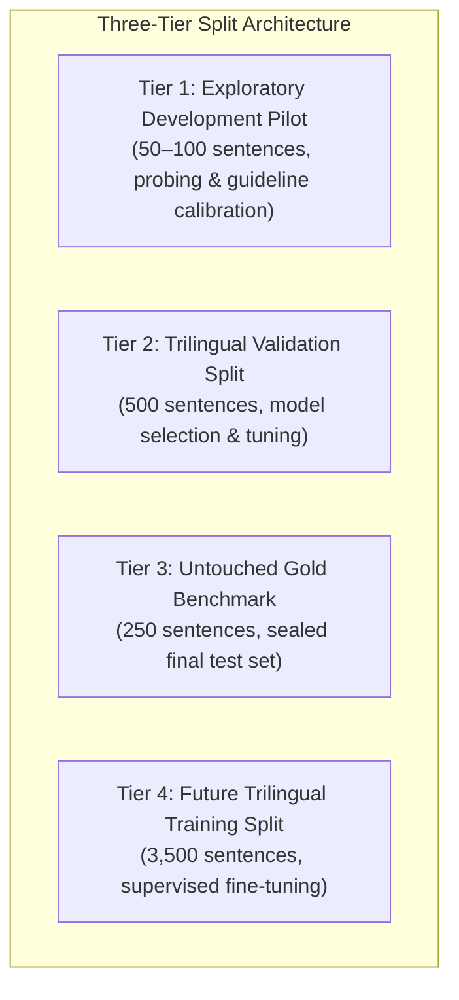

# CodeMix Intelligence V2.1 — Trilingual Dataset Design Specification
## Target-Domain Dataset Architecture for English-Hindi-Telugu Token-Level Language Identification

**Document Version:** `2.0.0`  
**Date:** 2026-11-13  
**Status:** Approved Dataset & Evaluation Architecture  
**Target Directory:** [`outputs/experiments/trilingual_lid_v2_1/`](file:///C:/Users/YOGESWAR/OneDrive/Apps/CodeMix-Intelligence/outputs/experiments/trilingual_lid_v2_1/)  
**Baseline Model Reference:** `google/muril-base-cased` (V1 LID Baseline)  
**Companion Documents:**
- [ANNOTATION_GUIDELINES.md](file:///C:/Users/YOGESWAR/OneDrive/Apps/CodeMix-Intelligence/outputs/experiments/trilingual_lid_v2_1/ANNOTATION_GUIDELINES.md)
- [DATASET_SCHEMA.md](file:///C:/Users/YOGESWAR/OneDrive/Apps/CodeMix-Intelligence/outputs/experiments/trilingual_lid_v2_1/DATASET_SCHEMA.md)
- [SOURCE_AND_LICENSING_AUDIT.md](file:///C:/Users/YOGESWAR/OneDrive/Apps/CodeMix-Intelligence/outputs/experiments/trilingual_lid_v2_1/SOURCE_AND_LICENSING_AUDIT.md)
- [PILOT_EVALUATION_DESIGN.md](file:///C:/Users/YOGESWAR/OneDrive/Apps/CodeMix-Intelligence/outputs/experiments/trilingual_lid_v2_1/PILOT_EVALUATION_DESIGN.md)

---

## 1. Context, Motivation & Problem Statement

### 1.1 The Contextual Contamination Defect in V1
The CodeMix Intelligence V1 token-level language identification model achieves $98.17\%$ accuracy and $98.01\%$ Macro F1 on the locked V1 test set. However, controlled diagnostic experiments revealed a fundamental failure mode:
- **Zero Co-occurrence in Training:** The V1 training corpus ($43,369$ sentences) combined two disjoint sources: COMI-LINGUA (English-Hindi code-mixing) and Telugu-English Blog/Twitter (English-Telugu code-mixing). Crucially, the training corpus contained exactly **0 Hindi-Telugu bilingual sentences** and **0 English-Hindi-Telugu trilingual sentences** across all 63,044 sentences in the corpus.
- **Bidirectional Self-Attention Prior:** In MuRIL's 12-layer transformer architecture, all tokens attend to all other tokens. Because Hindi and Telugu never co-occurred in training, the bidirectional self-attention layers learned an empirical prior: $P(\text{HI} \mid \text{sentence contains TE}) \approx 0$.
- **Failure Mode:** When Romanized Hindi and Romanized Telugu appear in the same input (e.g. *"mai kal morning school ku aatta huu, akkada adukundam.*"), strong Telugu tokens (`akkada`, `adukundam`, `ku`) propagate a dominant Telugu contextual prior that overwhelms Romanized Hindi tokens (`mai`, `kal`), causing a 100% false-negative rate for Hindi.
- **Experimental Diagnostic Finding:** Segmenting clauses at punctuation boundaries restores Hindi confidence from 0% to $>93\%$. However, this is ineffective for continuous unpunctuated chat text.

### 1.2 Core Architectural Objective
To resolve this defect fundamentally through principled dataset curation and evaluation—**without relying on fragile posthoc inference heuristics or arbitrary token-splitting rules**—CodeMix Intelligence V2.1 establishes a curated target-domain trilingual dataset covering authentic human code-mixing.

---

## 2. Target Domain Scope & Linguistic Coverage Requirements

The V2.1 dataset is engineered to cover the complete linguistic spectrum of trilingual communication common in multilingual Indian metropolitan contexts (e.g., Hyderabad, Telangana, Delhi-NCR, Bangalore):



### 2.1 The Ten Mandatory Coverage Dimensions
1. **English-Hindi-Telugu Trilingual Sentences:** Authentic communicative turns where all three languages are present intra-sententially (e.g., English technical noun + Hindi modal clause + Telugu predicate clause).
2. **Hindi-Telugu Bilingual Sentences:** Direct code-switching between Hindi and Telugu without English matrix scaffolding (e.g., conversational turns in shared multilingual regions).
3. **Language Order Permutations:** Systematic variation of language transition points:
   - $\text{EN} \rightarrow \text{HI} \rightarrow \text{TE}$
   - $\text{HI} \rightarrow \text{EN} \rightarrow \text{TE}$
   - $\text{TE} \rightarrow \text{EN} \rightarrow \text{HI}$
   - $\text{HI} \rightarrow \text{TE} \rightarrow \text{EN}$
   - $\text{TE} \rightarrow \text{HI} \rightarrow \text{EN}$
   - Alternating multi-point code-switching ($\text{HI} \rightarrow \text{TE} \rightarrow \text{HI} \rightarrow \text{EN}$).
4. **Romanized Hindi and Telugu:** Informal phonological transliterations (Hinglish and Tenglish) using the Latin alphabet.
5. **Native-Script Hindi and Telugu:** Sentences featuring standard Devanagari script for Hindi and standard Telugu script for Telugu.
6. **Mixed-Script Formats:** Sentences combining native scripts and Latin transliterations within the same turn (e.g., Devanagari Hindi + Romanized Telugu + English, or Telugu script + Romanized Hindi).
7. **Conversational & Non-Standard Spelling Variations:** Natural transliteration noise prevalent in digital chat:
   - Hindi variations: `aatta` / `aata`, `huu` / `hu` / `hoon`, `kya` / `kyaa`, `bahut` / `bhot`.
   - Telugu variations: `chala` / `chaala`, `kuda` / `kooda`, `enti` / `yenti`, `akkada` / `akkadaa`.
8. **Punctuation Diversity:**
   - Standard punctuated sentences (commas, periods, question marks separating clauses).
   - Unpunctuated continuous running turns (typical of mobile messaging).
9. **Sentence Length Stratification:**
   - Short turns (2–5 words): Quick chat responses and exclamations.
   - Medium turns (6–15 words): Standard conversational code-mixed turns.
   - Long turns (16–35 words): Multi-clause narrative posts and complex dialogue.
10. **Shared Vocabulary, Loanwords, and Borrowings:**
    - Sanskrit cognates (*tatsama*) shared between Hindi and Telugu (e.g., `shanti`, `pustak`, `samayam`, `pranam`, `dost`, `duniya`).
    - English technical and colloquial loanwords (e.g., `office`, `school`, `meeting`, `mobile`, `bus`, `ticket`).
    - Dakhni / Hyderabadi contact forms (e.g., postposition `ku`, discourse marker `ich`).

---

## 3. Ambiguous Token & Evaluation Policy

The supervised classification model maintains a strictly defined **4-class output taxonomy**:

$$\text{EN} = 0, \quad \text{HI} = 1, \quad \text{TE} = 2, \quad \text{OTHER} = 3$$

To guarantee scientific rigor, prevent label pollution, and maintain evaluation integrity, the project enforces the following non-negotiable evaluation rules:

### 3.1 Taxonomy and Model Label Mapping

```text
Scorable Target Classes:
  EN    (0)  : English word
  HI    (1)  : Hindi word (Devanagari or Romanized)
  TE    (2)  : Telugu word (Telugu script or Romanized)
  OTHER (3)  : Punctuation, digits, symbols, emojis

Non-Target / Loss-Masked Classes (Mapped to -100):
  AMBIGUOUS (-100) : Genuinely shared cognate with indeterminate syntactic matrix
  NE        (-100) : Proper named entity (person, organization, location)
  MIXED     (-100) : Intra-word morphemic blend (e.g. English stem + Telugu clitic)
```

### 3.2 Strict Evaluation Invariants

1. **Strict Prohibition Against Coercion:**  
   Under **no circumstances** may tokens annotated as `AMBIGUOUS`, `NE`, or `MIXED` be silently converted into `EN`, `HI`, `TE`, or `OTHER` during preprocessing, training, or evaluation. Doing so corrupts label semantics and penalizes models for predicting linguistically valid interpretations.
2. **PyTorch Loss Masking:**  
   During training and validation loss computation, all tokens with model label `-100` are ignored by PyTorch's loss function:
   $$\mathcal{L} = \text{CrossEntropyLoss}(\text{ignore\_index} = -100)$$
3. **Scorable vs. All-Token Reporting Separation:**  
   Benchmark results must **never present scorable-token accuracy as all-token accuracy**. Evaluation reports must explicitly document:
   - **Scorable Token Universe ($N_{\text{scorable}}$):** The exact denominator of evaluated tokens possessing target labels $\in \{\text{EN}, \text{HI}, \text{TE}, \text{OTHER}\}$.
   - **Excluded Token Universe ($N_{\text{masked}}$):** The exact count and proportion of tokens with labels $\in \{\text{AMBIGUOUS}, \text{NE}, \text{MIXED}\}$ excluded from primary scoring.
   - **Diagnostic Reporting:** A dedicated diagnostic confusion analysis tracking how the model classifies these masked tokens (e.g., whether `NE` tokens are predicted as `OTHER` or the matrix language).

---

## 4. Planned Dataset Volumes and Split Architecture



| Partition | Target Sentences | Target Tokens | Role & Leakage Safeguard |
| :--- | :---: | :---: | :--- |
| **Exploratory Pilot Benchmark (`v2_1_dev_pilot`)** | 50–100 | $\sim 1,000$ | Diagnostic probing, annotator training, and guideline calibration. Kept separate from validation and test splits. |
| **Trilingual Validation Set (`v2_1_val`)** | 500 | $\sim 6,500$ | Model checkpoint selection and threshold calibration. Disjoint speakers and prompt groups from test. |
| **Untouched Gold Benchmark (`v2_1_gold_test`)** | **250** | $\sim 3,500$ | **Strictly held-out, sealed final evaluation benchmark.** 100% dual-annotated with zero speaker, session, or prompt overlap. |
| **Trilingual Training Addition (`v2_1_train`)** | 3,500 | $\sim 45,000$ | Supervised fine-tuning corpus. Combined with frozen V1 background data to eliminate contextual interference. |

> [!IMPORTANT]
> **Preservation Guarantee:** The legacy V1 test set ($14,855$ sentences, $199,219$ tokens) remains completely frozen and will be evaluated alongside the V2.1 Gold Benchmark as an independent regression baseline.
