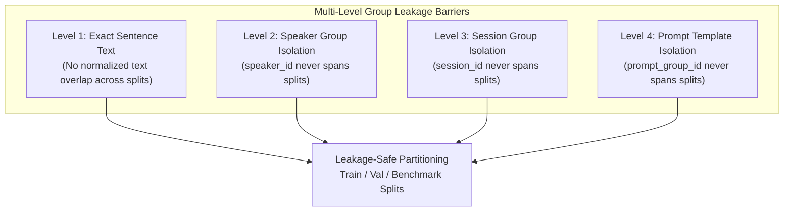

# CodeMix Intelligence V2.1 — Dataset Schema Specification
## Dual-Format Architecture: Token-Level CSV & Sentence-Level JSONL

**Document Version:** `2.0.0`  
**Date:** 2026-11-13  
**Status:** Approved Schema Specification  
**Target Directory:** [`outputs/experiments/trilingual_lid_v2_1/`](file:///C:/Users/YOGESWAR/OneDrive/Apps/CodeMix-Intelligence/outputs/experiments/trilingual_lid_v2_1/)  
**Companion Documents:**
- [ANNOTATION_GUIDELINES.md](file:///C:/Users/YOGESWAR/OneDrive/Apps/CodeMix-Intelligence/outputs/experiments/trilingual_lid_v2_1/ANNOTATION_GUIDELINES.md)
- [SOURCE_AND_LICENSING_AUDIT.md](file:///C:/Users/YOGESWAR/OneDrive/Apps/CodeMix-Intelligence/outputs/experiments/trilingual_lid_v2_1/SOURCE_AND_LICENSING_AUDIT.md)
- [PILOT_EVALUATION_DESIGN.md](file:///C:/Users/YOGESWAR/OneDrive/Apps/CodeMix-Intelligence/outputs/experiments/trilingual_lid_v2_1/PILOT_EVALUATION_DESIGN.md)

---

## 1. Schema Overview

The CodeMix Intelligence V2.1 dataset architecture supports two interoperable, synchronized data formats:

1. **Token-Level CSV (`annotation_template.csv`):**  
   Designed for human annotators, blind pass reviewers, and senior adjudicators. Each row represents a single word or punctuation token, explicitly bound to its parent sentence with character offsets, provenance, consent scope, and workflow status.
2. **Sentence-Level JSONL (`*.jsonl`):**  
   Designed for the PyTorch / Hugging Face model training and evaluation pipeline. Each line represents a single sentence containing synchronized token arrays, character offset matrices, model label arrays, and rich governance metadata.

### Core Schema Principles:
- **Exact Offset Integrity:** For every token $i$, `sentence_text[char_start : char_end] == token`.
- **Loss Mask Separation:** Scorable labels (`EN`, `HI`, `TE`, `OTHER`) map to integer IDs `0, 1, 2, 3`. Ambiguous or non-target labels (`AMBIGUOUS`, `NE`, `MIXED`) map to `-100` (`ignore_index`).
- **Multi-Level Group Leakage Barriers:** Explicit identifiers (`speaker_id`, `session_id`, `prompt_group_id`) prevent cross-split leakage across train, validation, and test splits.
- **Auditable Provenance & Consent:** Each token carries explicit provenance, consent scope, and dual-annotation workflow tracking.

---

## 2. Format 1: Token-Level CSV Schema

### 2.1 Column Definitions

| Column Name | Type | Nullable | Description & Constraints | Example |
| :--- | :---: | :---: | :--- | :--- |
| `sentence_id` | String | No | Unique sentence identifier. Regex: `^tri_v21_[0-9]{6}$` | `tri_v21_000001` |
| `sentence_text` | String | No | Full verbatim sentence string. Must match across all tokens of the sentence. | `mai kal morning school ku aatta huu, akkada adukundam.` |
| `token_index` | Integer | No | 0-based token index within the sentence. Must be strictly sequential. | `0` |
| `token` | String | No | Exact surface string of the token. | `mai` |
| `char_start` | Integer | No | 0-based inclusive character start offset in `sentence_text`. | `0` |
| `char_end` | Integer | No | 0-based exclusive character end offset in `sentence_text`. | `3` |
| `language_label` | String | No | Enum: `EN`, `HI`, `TE`, `OTHER`, `AMBIGUOUS`, `NE`, `MIXED`. | `HI` |
| `writing_system` | String | No | Enum: `latin_romanized`, `devanagari`, `telugu_script`, `numeric_symbol`. | `latin_romanized` |
| `speaker_id` | String | No | Pseudonymous contributor ID. Regex: `^spk_[0-9]{4}$` | `spk_0012` |
| `session_id` | String | No | Contributor session ID. Regex: `^sess_[0-9]{4}$` | `sess_0045` |
| `prompt_group_id` | String | No | Scenario / prompt template group. Regex: `^prompt_grp_[0-9]{3,}$` | `prompt_grp_008` |
| `source_group_id` | String | No | Backward-compatible partition grouping ID. Set to `prompt_group_id` or `speaker_id`. | `grp_hyd_chat_01` |
| `consent_scope` | String | No | Enum: `public_cc_by_4_0`, `academic_research_only`, `internal_pilot`. | `public_cc_by_4_0` |
| `source_provenance`| String | No | Provenance descriptor (e.g. `human_elicitation_hyd`, `bht25_reference`). | `human_elicitation_hyd` |
| `annotation_status`| String | No | Workflow status: `raw`, `annotated_pass1`, `annotated_pass2`, `adjudicated`, `verified`. | `verified` |
| `adjudication_status`| String | No | Discrepancy resolution: `unadjudicated`, `agreed`, `adjudicated_resolved`, `adjudicated_disputed`. | `agreed` |
| `annotator_id` | String | No | Pseudonymous annotator/reviewer ID. Regex: `^annotator_[0-9]{2,}$` | `annotator_01` |
| `notes` | String | Yes | Optional linguistic notes (e.g., etymology, transliteration variant). | `variant of aata` |

---

## 3. Format 2: Sentence-Level JSONL Schema

Each line of the JSONL file represents a single complete sentence record:

```json
{
  "sentence_id": "tri_v21_000001",
  "text": "mai kal morning school ku aatta huu, akkada adukundam.",
  "tokens": ["mai", "kal", "morning", "school", "ku", "aatta", "huu", ",", "akkada", "adukundam", "."],
  "char_offsets": [
    [0, 3],
    [4, 7],
    [8, 15],
    [16, 22],
    [23, 25],
    [26, 31],
    [32, 35],
    [35, 36],
    [37, 43],
    [44, 53],
    [53, 54]
  ],
  "labels": ["HI", "HI", "EN", "EN", "TE", "HI", "HI", "OTHER", "TE", "TE", "OTHER"],
  "model_labels": [1, 1, 0, 0, 2, 1, 1, 3, 2, 2, 3],
  "writing_systems": [
    "latin_romanized",
    "latin_romanized",
    "latin_romanized",
    "latin_romanized",
    "latin_romanized",
    "latin_romanized",
    "latin_romanized",
    "numeric_symbol",
    "latin_romanized",
    "latin_romanized",
    "numeric_symbol"
  ],
  "metadata": {
    "speaker_id": "spk_0012",
    "session_id": "sess_0045",
    "prompt_group_id": "prompt_grp_008",
    "source_group_id": "prompt_grp_008",
    "consent_scope": "public_cc_by_4_0",
    "source_provenance": "human_elicitation_hyd",
    "collection_method": "human_elicited",
    "license": "CC-BY-4.0",
    "annotator_pass1": "annotator_01",
    "annotator_pass2": "annotator_02",
    "adjudicator_id": "annotator_senior",
    "annotation_status": "verified",
    "adjudication_status": "agreed",
    "language_combination": "EN_HI_TE",
    "has_punctuation": true,
    "script_type": "latin_romanized",
    "language_token_counts": {
      "EN": 2,
      "HI": 4,
      "TE": 3,
      "OTHER": 2,
      "AMBIGUOUS": 0,
      "NE": 0,
      "MIXED": 0
    }
  }
}
```

---

## 4. Multi-Level Group Leakage Prevention Architecture

Data leakage between training, validation, and test partitions causes over-optimistic evaluation metrics and fails to measure true generalization. The V2.1 schema provides four independent levels of group isolation:



### 4.1 The Four Group Leakage Invariants
1. **Zero Text Overlap:**  
   No normalized sentence text (`normalize_whitespace(text)`) occurring in the Training split may ever appear in the Validation or Final Test Benchmark splits.
2. **Speaker Isolation (`speaker_id`):**  
   Every contributor is assigned to exactly one split. All sentences authored by `spk_0012` must reside exclusively within that participant's assigned partition. This ensures the model is evaluated on unseen speakers.
3. **Session Isolation (`session_id`):**  
   No conversational dialogue session may be sliced across split boundaries. Co-referential context and conversational topics remain strictly contained.
4. **Prompt Group Isolation (`prompt_group_id`):**  
   Sentences generated in response to the same conversational elicitation prompt or communicative scenario (e.g., *"discussing travel to office"* or *"ordering food in Hyderabad"*) must not span across splits. This ensures the benchmark evaluates lexical and syntactic generalization, not memorization of specific prompt scenarios.

---

## 5. Strict Validation Invariants

Any dataset validator operating on this schema must enforce the following invariants:

1. **Character Offset Parity:**  
   For every token $i$, `text[char_offsets[i][0] : char_offsets[i][1]] == tokens[i]`.
2. **Array Length Parity:**  
   `len(tokens) == len(char_offsets) == len(labels) == len(model_labels) == len(writing_systems)`.
3. **Deterministic Model Label Mapping:**
   - `EN` $\rightarrow$ `0`
   - `HI` $\rightarrow$ `1`
   - `TE` $\rightarrow$ `2`
   - `OTHER` $\rightarrow$ `3`
   - `AMBIGUOUS`, `NE`, `MIXED` $\rightarrow$ `-100` (PyTorch `ignore_index`)
4. **Group Isolation Verification:**  
   $\text{Speakers}(\text{Train}) \cap \text{Speakers}(\text{Val}) = \emptyset$, $\text{Speakers}(\text{Train}) \cap \text{Speakers}(\text{Test}) = \emptyset$, $\text{Speakers}(\text{Val}) \cap \text{Speakers}(\text{Test}) = \emptyset$.  
   Similarly for `session_id`, `prompt_group_id`, and `source_group_id`.
5. **Consent Scope Legality:**  
   Records tagged with `consent_scope == "academic_research_only"` or `"internal_pilot"` must be automatically barred from inclusion in public release archives.
