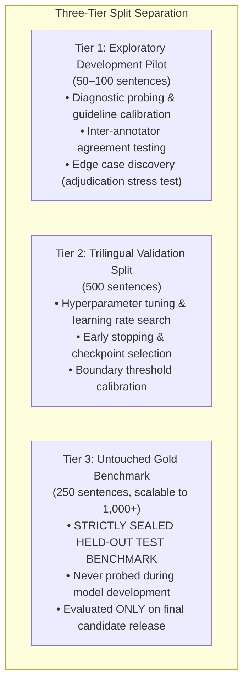
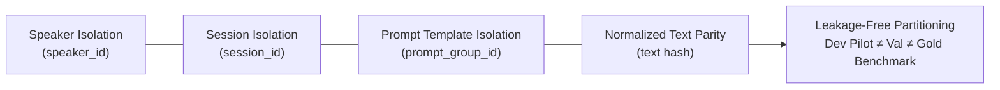
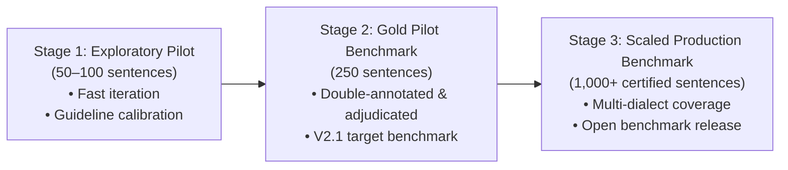

# CodeMix Intelligence V2.1 — Pilot Evaluation Set Design
## Stratified Trilingual Benchmark Specification & Split Distinction Protocol

**Document Version:** `2.0.0`  
**Date:** 2026-11-13  
**Status:** Approved Benchmark Specification  
**Target Directory:** [`outputs/experiments/trilingual_lid_v2_1/`](file:///C:/Users/YOGESWAR/OneDrive/Apps/CodeMix-Intelligence/outputs/experiments/trilingual_lid_v2_1/)  
**Companion Documents:**
- [DATASET_DESIGN.md](file:///C:/Users/YOGESWAR/OneDrive/Apps/CodeMix-Intelligence/outputs/experiments/trilingual_lid_v2_1/DATASET_DESIGN.md)
- [ANNOTATION_GUIDELINES.md](file:///C:/Users/YOGESWAR/OneDrive/Apps/CodeMix-Intelligence/outputs/experiments/trilingual_lid_v2_1/ANNOTATION_GUIDELINES.md)
- [DATASET_SCHEMA.md](file:///C:/Users/YOGESWAR/OneDrive/Apps/CodeMix-Intelligence/outputs/experiments/trilingual_lid_v2_1/DATASET_SCHEMA.md)
- [SOURCE_AND_LICENSING_AUDIT.md](file:///C:/Users/YOGESWAR/OneDrive/Apps/CodeMix-Intelligence/outputs/experiments/trilingual_lid_v2_1/SOURCE_AND_LICENSING_AUDIT.md)

---

## 1. Clean Separation of Evaluation Splits

To ensure research integrity, avoid methodological circularity, and prevent hyperparameter tuning from contaminating evaluation results, the project strictly delineates three distinct data collections:

### 1.1 Split Definitions and Roles
1. **Tier 1 — Exploratory Development Pilot Benchmark (50–100 Sentences):**
   - **Role:** An open exploratory testbed used to evaluate baseline model weaknesses, conduct initial inter-annotator agreement trials, test annotation guidelines, and calibrate adjudication protocols.
   - **Access Policy:** Permissible to inspect token-by-token and error-analyze repeatedly. It is **never** used as a formal test benchmark.
2. **Tier 2 — Trilingual Validation Split (500 Sentences):**
   - **Role:** Dedicated validation split used during model training for early stopping, model checkpoint selection, and hyperparameter tuning.
   - **Access Policy:** Evaluated automatically by training harnesses; strictly isolated from the Gold Benchmark.
3. **Tier 3 — Future Untouched Final Test Benchmark (250 Sentences, Scalable to 1,000+):**
   - **Role:** The authoritative, held-out gold test benchmark for V2.1.
   - **Access Policy:** **Strictly sealed.** No model development, prompt engineering, or threshold tuning may consult this benchmark. Evaluated exactly once per model candidate to guarantee true generalizability.

---

## 2. Multi-Level Group Isolation & Leakage Prevention

To prevent cross-split leakage, all data partitioning must enforce strict multi-level isolation across four independent boundaries:

### Isolation Rules:
- **Rule 1 (Speaker Disjointness):** Every contributor (`speaker_id`) is assigned to exactly one partition:
  $$\text{Speakers}(\text{Dev Pilot}) \cap \text{Speakers}(\text{Val}) = \emptyset, \quad \text{Speakers}(\text{Val}) \cap \text{Speakers}(\text{Gold}) = \emptyset$$
- **Rule 2 (Session Disjointness):** Conversational dialogues or elicitation blocks (`session_id`) cannot be split across sets.
- **Rule 3 (Prompt Group Disjointness):** Communicative prompt scenarios (`prompt_group_id`) must be strictly partitioned so that the test set evaluates unseen conversational scenarios.
- **Rule 4 (Zero Text Duplication):** Normalized text strings cannot exist across multiple partitions.

---

## 3. Stratification Matrix for the 250-Sentence Gold Benchmark

The 250-sentence gold benchmark ($\sim 3,500$ supervised tokens) is stratified across five orthogonal linguistic dimensions:

### 3.1 Dimension 1: Language Mixture Distribution
| Language Mixture Category | Sentence Count | Target Proportion | Core Linguistic Focus |
| :--- | :---: | :---: | :--- |
| **EN-HI-TE Trilingual** | **100** | $40.0\%$ | Intra-sentential co-occurrence of all three languages in a single turn |
| **HI-TE Bilingual** | **60** | $24.0\%$ | Direct Hindi-Telugu code-switching without English matrix scaffolding |
| **EN-HI Bilingual Controls** | **30** | $12.0\%$ | High-difficulty colloquial Hinglish control |
| **EN-TE Bilingual Controls** | **30** | $12.0\%$ | High-difficulty colloquial Tenglish control |
| **Monolingual Controls** | **30** | $12.0\%$ | 10 pure English, 10 pure Hindi, 10 pure Telugu sentences |
| **Total Benchmark Size** | **250** | **100.0%** | Comprehensive cross-lingual representation |

### 3.2 Dimension 2: Language Transition Order (Across 100 Trilingual Sentences)
- $\text{EN} \rightarrow \text{HI} \rightarrow \text{TE}$: 20 sentences (e.g. English main clause, Hindi subordinate clause, Telugu predicate).
- $\text{HI} \rightarrow \text{EN} \rightarrow \text{TE}$: 20 sentences (e.g. Hindi topic, English object, Telugu verb).
- $\text{TE} \rightarrow \text{EN} \rightarrow \text{HI}$: 20 sentences (e.g. Telugu subject, English noun phrase, Hindi modal tag).
- $\text{HI} \rightarrow \text{TE} \rightarrow \text{EN}$: 15 sentences.
- $\text{TE} \rightarrow \text{HI} \rightarrow \text{EN}$: 15 sentences.
- **Interleaved Multi-Switch ($\ge 3$ switches):** 10 sentences (e.g. $\text{HI} \rightarrow \text{TE} \rightarrow \text{HI} \rightarrow \text{EN}$).

### 3.3 Dimension 3: Writing System & Script Distribution
| Script Configuration | Sentence Count | Proportion | Examples |
| :--- | :---: | :---: | :--- |
| **Pure Romanized (Latin Script)** | **150** | $60.0\%$ | Romanized Hinglish + Romanized Tenglish + English |
| **Pure Native Scripts** | **50** | $20.0\%$ | Devanagari Hindi + Telugu script Telugu + Latin English |
| **Mixed Scripts** | **50** | $20.0\%$ | Devanagari Hindi + Romanized Telugu, or Telugu script + Romanized Hindi |

### 3.4 Dimension 4: Punctuation Realism
- **Punctuated Sentences (60% / 150 sentences):** Includes commas, semicolons, hyphens, and periods demarcating clauses.
- **Unpunctuated Sentences (40% / 100 sentences):** Continuous running turns with zero punctuation, replicating informal mobile messaging where contextual interference is most severe.

### 3.5 Dimension 5: Lexical Complexity and Ambiguity
- **Shared Cognates (*tatsama* / Perso-Arabic borrowings):** 50 sentences containing shared lexemes (e.g., `pustak`, `samayam`, `shanti`, `dost`, `duniya`).
- **English + Native Clitics:** 40 sentences containing case markers attached to English stems (e.g., `school ku`, `office lo`, `meeting ki`).
- **Non-Standard Transliteration Noise:** 40 sentences featuring colloquial phonetic variants (e.g., `aatta`, `huu`, `chaala`, `plzzz`).
- **Standard Unambiguous Turns:** 120 sentences.

---

## 4. Ambiguous Token Evaluation Policy & Reporting Protocol

The evaluation protocol enforces a strict mathematical and operational distinction between **scorable target tokens** and **excluded non-target tokens**:

### 4.1 Strict Distinction Invariant
- **Primary Scorable Metrics:** Evaluated strictly over tokens belonging to the four target classes:
  $$\mathcal{C}_{\text{scorable}} = \{\text{EN}, \text{HI}, \text{TE}, \text{OTHER}\}$$
  with denominators computed as $N_{\text{scorable}} = \sum_{c \in \mathcal{C}_{\text{scorable}}} (\text{TP}_c + \text{FN}_c)$.
- **Strict Prohibition on Coercion:** Under no circumstances may `AMBIGUOUS`, `NE`, or `MIXED` tokens be silently mapped to `OTHER` or coerced into a target language.
- **Prohibition on Misrepresentation:** Scorable accuracy must **never** be reported as "all-token accuracy". Reports must explicitly declare:
  $$\text{Scorable Token Accuracy} = \frac{\sum_{c \in \mathcal{C}_{\text{scorable}}} \text{TP}_c}{N_{\text{scorable}}}$$
  and state the exclusion rate:
  $$\text{Masked Token Rate} = \frac{N_{\text{masked}}}{N_{\text{total}}} \times 100\%$$
  where $N_{\text{masked}} = N_{\text{AMBIGUOUS}} + N_{\text{NE}} + N_{\text{MIXED}}$.

### 4.2 Diagnostic Reporting for Masked Tokens
In addition to the primary $4 \times 4$ confusion matrix, every benchmark evaluation report must include a **Non-Scorable Diagnostic Table**:

| Non-Scorable Category | Gold Token Count | Percentage of Benchmark | Top Predicted Labels by Model | Linguistic Diagnosis |
| :--- | :---: | :---: | :---: | :--- |
| **`AMBIGUOUS`** | $T_{\text{amb}}$ | $T_{\text{amb}} / N_{\text{total}}$ | e.g. 60% HI, 40% TE | Tracks whether model leans toward matrix language |
| **`NE`** | $T_{\text{ne}}$ | $T_{\text{ne}} / N_{\text{total}}$ | e.g. 50% EN, 30% HI, 20% TE | Tracks whether named entities trigger language bias |
| **`MIXED`** | $T_{\text{mix}}$ | $T_{\text{mix}} / N_{\text{total}}$ | e.g. 70% TE, 30% EN | Tracks whether stem or affix dominates subword attention |

---

## 5. Benchmark Expansion Strategy

The V2.1 benchmark follows a progressive, staged expansion roadmap:

1. **Stage 1 — Exploratory Pilot (50–100 Sentences):** Focuses on guideline stress-testing and agreement measurement with a small group of bilingual annotators.
2. **Stage 2 — Certified 250-Sentence Gold Pilot:** The core target benchmark detailed in this document, providing statistical power ($\sim 3,500$ tokens) to verify resolution of the contextual contamination defect.
3. **Stage 3 — Scaled Production Benchmark (1,000+ Sentences):** Expansion to 1,000+ fully adjudicated sentences incorporating broader regional dialects (e.g., Coastal Andhra Telugu, Rayalaseema Telugu, Mumbai Hindi-English) for comprehensive academic benchmarking.
