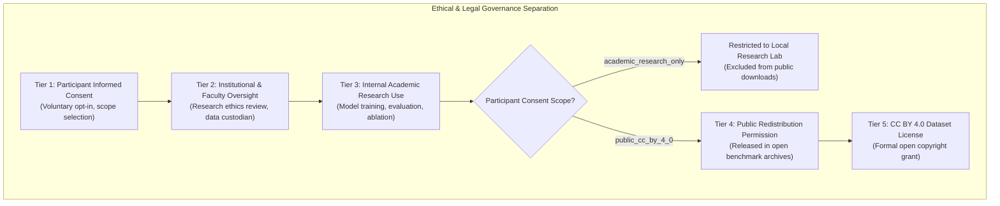

# CodeMix Intelligence V2.1 — Source & Licensing Audit
## Provenance, Governance, Legal Compliance, and Participant Ethics

**Document Version:** `2.0.0`  
**Date:** 2026-11-13  
**Status:** Approved Source, Licensing & Ethics Protocol  
**Target Directory:** [`outputs/experiments/trilingual_lid_v2_1/`](file:///C:/Users/YOGESWAR/OneDrive/Apps/CodeMix-Intelligence/outputs/experiments/trilingual_lid_v2_1/)  
**Companion Documents:**
- [ANNOTATION_GUIDELINES.md](file:///C:/Users/YOGESWAR/OneDrive/Apps/CodeMix-Intelligence/outputs/experiments/trilingual_lid_v2_1/ANNOTATION_GUIDELINES.md)
- [DATASET_SCHEMA.md](file:///C:/Users/YOGESWAR/OneDrive/Apps/CodeMix-Intelligence/outputs/experiments/trilingual_lid_v2_1/DATASET_SCHEMA.md)
- [PILOT_EVALUATION_DESIGN.md](file:///C:/Users/YOGESWAR/OneDrive/Apps/CodeMix-Intelligence/outputs/experiments/trilingual_lid_v2_1/PILOT_EVALUATION_DESIGN.md)

---

## 1. Audit of Existing V1 Datasets

The V1 training and evaluation datasets in `data/processed/language_identification/` were audited for legal reusability, provenance integrity, and linguistic boundary conditions:

| Dataset Component | Source Origin | License / Terms | Record Count (Train / Val / Test) | Safe to Reuse in V2.1? | Limitations & Remediation |
| :--- | :--- | :---: | :---: | :---: | :--- |
| **COMI-LINGUA (English-Hindi)** | Microsoft Research / Academic Release | Academic Research License | 23,343 / 2,594 / 4,944 | **YES (Background Anchor)** | **Limitation:** Contains 0 Telugu tokens. Reusable exclusively as background English-Hindi code-mixed anchor to prevent catastrophic forgetting. |
| **Telugu-English Blog** | Academic Crawl (Gautam et al.) | CC BY 4.0 / Academic Use | 5,874 / 653 / 3,105 | **YES (Background Anchor)** | **Limitation:** Contains 0 Hindi tokens; 100% Romanized (0 native script). |
| **Telugu-English Twitter** | Academic Twitter Corpus (Gautam et al.) | CC BY 4.0 / Academic Use | 14,152 / 1,573 / 6,806 | **YES (Background Anchor)** | **Limitation:** Contains 0 Hindi tokens. Reusable as background English-Telugu anchor. |

> [!NOTE]
> All 63,044 sentences across V1 train, val, and test splits remain completely frozen. The existing V1 test set ($14,855$ sentences, $199,219$ tokens) serves as the persistent historical baseline for backward regression testing.

---

## 2. Audit of External Candidate Sources for V2.1 Target Domain

To resolve the complete absence of Hindi-Telugu and English-Hindi-Telugu sentences, six potential external sources were evaluated against licensing, accessibility gates, and linguistic suitability:

| Candidate Dataset | Origin / Provider | Public URL / DOI | Declared License | Commercial Use | Access Gating | Linguistic Suitability & Policy |
| :--- | :--- | :--- | :---: | :---: | :---: | :--- |
| **BHT25** | Sudeshna Sani et al. (*Data in Brief* 2026) | [doi:10.1016/j.dib.2026.112775](https://doi.org/10.1016/j.dib.2026.112775) | **CC BY 4.0** | Allowed | Open (Ungated) | **SUITABLE WITH CONDITIONS:** Literary native Hindi and native Telugu parallel sentences. Parallel sentences must **NEVER** be artificially glued together. Suitable as vocabulary reference and parallel grounding. |
| **LTRC Hindi-Telugu** | IIIT Hyderabad | [Hugging Face](https://huggingface.co/datasets/ltrciiith/The-LTRC-Hindi-Telugu-Parallel-Corpus) | **CC-BY-NC 4.0** | **Prohibited** | **GATED** (Account sharing agreement) | **REFERENCE ONLY:** Non-commercial restriction limits downstream distribution. Gated access credentials must not be bypassed or embedded. |
| **Bhasha-Abhijnaanam** | AI4Bharat / IIT Madras | [arXiv:2305.15814](https://arxiv.org/abs/2305.15814) | **CC0-1.0** (benchmark) | Allowed | Open | **REFERENCE ONLY:** Dedicated out-of-distribution evaluation benchmark. Barred from candidate/training curation to prevent evaluation contamination. |
| **IndicCorp Telugu** | AI4Bharat | [indicnlp.ai4bharat.org](https://indicnlp.ai4bharat.org/corpora/) | **Unclear** | Unclear | Public links | **NOT SUITABLE / BARRED:** Web-scraped corpus with no clear data license declaration on public index. Classed as LICENSE UNCLEAR. |
| **Mozilla Common Voice Telugu** | Mozilla Data Collective | [cmu617jv900jfo107hpm9aj8d](https://mozilladatacollective.com) | CC0-1.0 (with clause) | Ambiguous | Rehosting Prohibited | **BARRED:** Dataset terms explicitly prohibit rehosting or redistribution, conflicting with project release packaging. |
| **Human Multilingual Elicitation** | Project Directed Contributor Sessions | Internal Protocol | **Consented / Tiered** | Conditionally Allowed | Direct Contributor Consent | **PRIMARY RECOMMENDED PATH:** Natural, authentic conversational code-mixed turns from native trilingual speakers (Hyderabad / Telangana). Zero gating, zero copyright infringement. |

---

## 3. Decoupling of Consent, Institutional Permission, and Dataset Licensing

A critical governance requirement for V2.1 is the formal decoupling of **individual participant consent**, **institutional research permission**, **academic internal use**, and **public redistribution licensing**.

### 3.1 Core Separation Principles
1. **Consent is Not a Copyright License:**  
   Informed consent by human participants to provide communicative turns is an ethical and privacy safeguard, whereas Creative Commons licenses (such as CC BY 4.0) govern intellectual property and copyright redistribution. The project must **never automatically apply CC BY 4.0** to human elicitations without explicit, separate consent from the participant permitting public open-source redistribution.
2. **Explicit Consent Scope Tiering:**  
   Every participant contribution is tagged with a mandatory `consent_scope` attribute in the dataset schema:
   - **`academic_research_only`**: The contributor consented to have their data analyzed internally for model training, validation, and academic paper reporting. **This data must never be published in downloadable release archives or public repositories.**
   - **`public_cc_by_4_0`**: The contributor explicitly opted in, with full knowledge, to release their anonymized turns under the Creative Commons Attribution 4.0 International license for public open-source distribution.
   - **`internal_pilot`**: Temporary exploratory calibration data used exclusively for annotator training and guideline refinement. Never released publicly.
3. **Institutional and Faculty Oversight:**  
   Data collection must be conducted under the direct supervision of an affiliated academic faculty member or principal investigator, adhering to institutional review board (IRB) ethical research guidelines.

---

## 4. Privacy, Anonymization, and Anti-Surveillance Standards

To ensure participant dignity and prevent accidental leakage of sensitive information, all data collection must conform to the following privacy standards:

### 4.1 Strict PII Exclusion Protocol
- **Zero Personally Identifiable Information (PII):**  
  Human contributions must contain **zero PII**. The following elements are strictly barred and must be rejected at ingestion or redacted during annotation:
  - Real personal names (family names, patronymics, full legal names).
  - Phone numbers, mobile numbers, and extension codes.
  - Physical postal addresses, street names, apartment numbers.
  - Email addresses, user handles, social media profile links.
  - Identification numbers (Aadhaar, PAN, passport, driving license, student roll numbers).
  - Financial records (bank accounts, UPI IDs, credit card numbers).
  - Passwords, access tokens, API keys, or private URLs.
- **Redaction Policy:** If a conversational turn contains a necessary personal reference, it must be replaced with a generic pseudonym (e.g. `Raju`, `Sita`) labeled as `NE` (`-100`).

### 4.2 Prohibition Against Scraping Private Chat Platforms
- The project strictly prohibits collecting, scraping, or harvesting chat logs from private messaging applications (WhatsApp, Telegram, Signal, private Discord channels, personal SMS) without explicit, documented participant opt-in and IRB approval.
- Contributing turns must be intentionally generated or shared during structured, consented elicitation sessions where participants are informed of the study's scope.

### 4.3 Pseudonymous Identification Architecture
- All contributor and session metadata must use pseudonymous identifiers with zero reversible linkages to real identities:
  - Contributor / Speaker: `spk_0001`, `spk_0002`, ...
  - Session Identifier: `sess_0001`, `sess_0002`, ...
  - Prompt Group: `prompt_grp_001`, `prompt_grp_002`, ...
  - Annotator Identifier: `annotator_01`, `annotator_02`, ...
- Real contributor identities and signed consent forms must be stored in a separate, encrypted offline directory managed by the faculty supervisor, completely isolated from the code and data repository.

### 4.4 Contributor Right to Withdrawal and Erasure
- Participants retain the right to withdraw their consent and have their data deleted at any point prior to the formal public freeze of the V2.1 benchmark.
- Upon receiving a withdrawal request referencing a participant's pseudonymous ID (`speaker_id`), the dataset custodian must immediately delete all associated rows from the repository, git staging, and intermediate CSV/JSONL files.

---

## 5. Summary of Compliance Invariants for Data Collection

1. **Zero LLM / Synthetic Ground Truth:** AI-generated sentences are strictly barred from ground truth training and evaluation sets.
2. **Prohibition of Mechanical Concatenation:** Parallel sentences from translation corpora must never be glued together with punctuation to simulate code-mixing.
3. **Consent Scope Verification:** No sentence with `consent_scope != "public_cc_by_4_0"` may be included in public release packages.
4. **Attribution Guarantee:** Any vocabulary reference derived from published academic works (e.g., BHT25) must retain appropriate academic citation.
