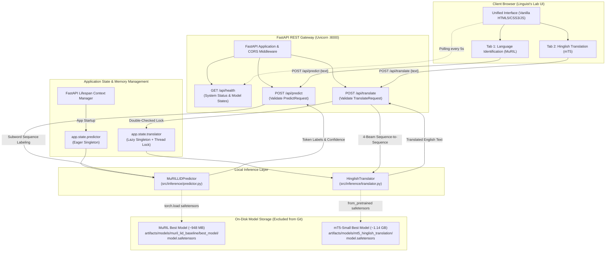

# CodeMix Intelligence V2.0.0 — Project Architecture

This document describes the software architecture, runtime execution flow, and component relationships of the CodeMix Intelligence V2 dual-model system.

---

## 1. System Architecture Overview

CodeMix Intelligence is designed as an asynchronous, decoupled machine learning web application capable of running token-level language identification and sequence-to-sequence neural machine translation in a single unified deployment.



---

## 2. Component Breakdown

### A. Frontend Tier (`frontend/`)
- **`frontend/index.html`**: Semantic document defining the "Linguist's Lab" interface. Contains the dual capability switcher tabs (`id="tab-lid"`, `id="tab-trans"`), separate input query forms, analytical stat widgets, and display areas.
- **`frontend/styles.css`**: CSS stylesheet built on CSS custom variables (`--paper`, `--ink`, `--vermilion`, `--azure`, `--forest`, `--font-serif`, `--font-sans`). Uses responsive grid and flexbox layouts with strict viewport boundaries (zero horizontal scroll).
- **`frontend/app.js`**: Modular JavaScript controller.
  - Implements tab switching with independent state preservation (`state.lid` vs `state.trans`).
  - Asynchronous fetch clients for `/api/predict`, `/api/translate`, and `/api/health`.
  - AbortController management for in-flight request cancellation.
  - Tabular and annotated token badge renderers for language identification results.
  - TSV and plain text clipboard export utilities.

### B. Application Gateway & API Tier (`backend/main.py`)
- **FastAPI Core**: Handles routing, lifecycle hooks, and CORS middleware for local and external browser origins.
- **Lifespan Context Manager**:
  - Automatically loads the MuRIL model during server initialization.
  - Ensures graceful shutdown and garbage collection when the server terminates.
- **Request/Response Pydantic Schemas**:
  - `PredictRequest`: Validates input text (1 to 2,000 characters).
  - `PredictResponse`: Returns token count, language distributions, average confidence, and per-token classifications.
  - `TranslateRequest`: Validates input text (1 to 1,000 characters).
  - `TranslateResponse`: Returns original text, translated English text, character counts, and model identifier (`google/mt5-small`).
  - `SystemHealthResponse`: Reports system uptime, PyTorch device, and individual model flags (`muril_loaded`, `mt5_loaded`).

### C. Inference Engines (`src/inference/`)
1. **`MuRILLIDPredictor` (`src/inference/predictor.py`)**:
   - Model: Fine-tuned `google/muril-base-cased` with linear classification head.
   - Device: Automatic CPU / CUDA detection with explicit FP32 fallback.
   - Long Paragraph Handling: Splits token sequences exceeding 254 WordPieces into overlapping chunks to preserve token integrity without truncation.
   - Arithmetic aggregation: Maps subword token logits to surface whitespace-separated words.

2. **`HinglishTranslator` (`src/inference/translator.py`)**:
   - Model: Fine-tuned `google/mt5-small` sequence-to-sequence model.
   - Model Directory: Resolves `artifacts/models/mt5_hinglish_translation/` relative to project root or `MT5_MODEL_DIR`.
   - Prefix Protocol: Prepend `"translate Hinglish to English: "` to every input (`MAX_SOURCE_LENGTH = 128`).
   - Sequence Length Limits: `max_source_length=128` limits the encoder input, while `max_length=128` caps the generated decoder sequence (including the decoder-start token).
   - Beam Search Generation:
     - `num_beams = 4`
     - `max_length = 128` (caps generated decoder sequence, not combined encoder+decoder)
     - `do_sample = False`
     - Note: `no_repeat_ngram_size`, `early_stopping`, and `length_penalty` are not passed as explicit keyword arguments to `model.generate()`; default generation configuration is utilized (`no_repeat_ngram_size=0`, `early_stopping=False`, `length_penalty=1.0`).
   - Concurrency & Thread Safety: Protected by `threading.Lock()` to prevent race conditions during concurrent inference or initial loading.

---

## 3. Concurrency & Lazy Loading Design

To optimize resource utilization and allow fast application startup on resource-constrained systems, Model 2 (mT5) utilizes a thread-safe double-checked lock lazy singleton pattern in `backend/main.py`:

```python
_translator_lock = threading.Lock()

def get_translator(request: Request) -> HinglishTranslator:
    translator = request.app.state.translator
    if translator is None:
        with _translator_lock:
            translator = request.app.state.translator
            if translator is None:
                translator = HinglishTranslator()
                request.app.state.translator = translator
    return translator
```

### Benefits:
- **Zero Cold-Start Overhead for LID**: Users only requiring Language Identification do not pay the ~1.14 GB RAM or ~6 second loading penalty of the translation model.
- **Deterministic Concurrency**: If multiple translation requests arrive simultaneously before initialization, only one thread instantiates the model while others safely wait.

